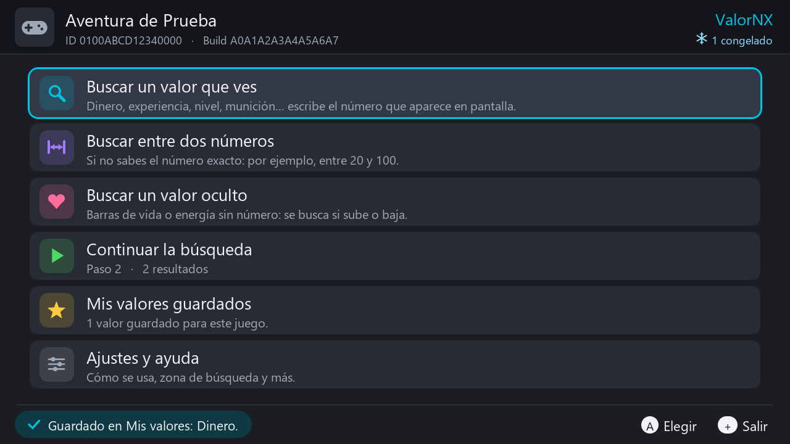
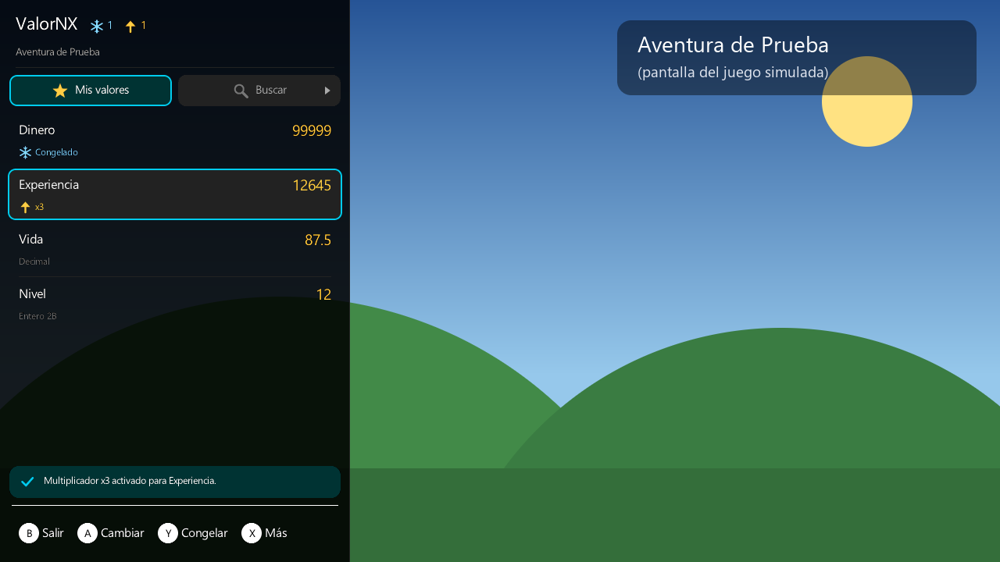
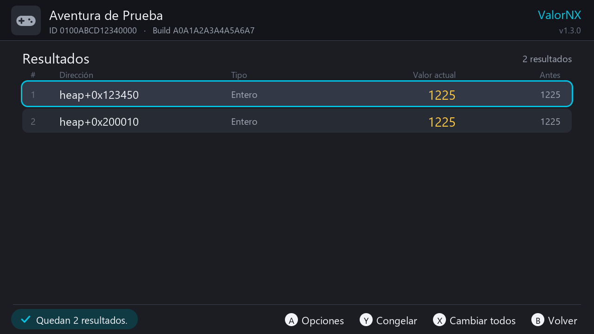
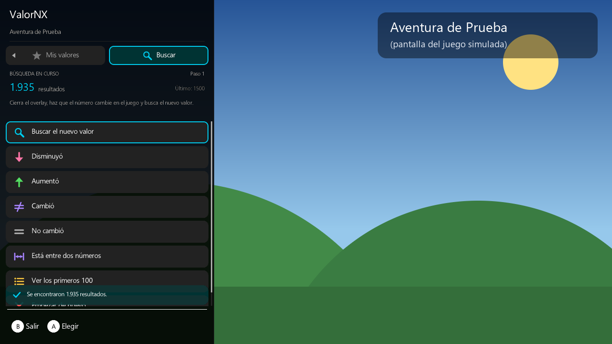
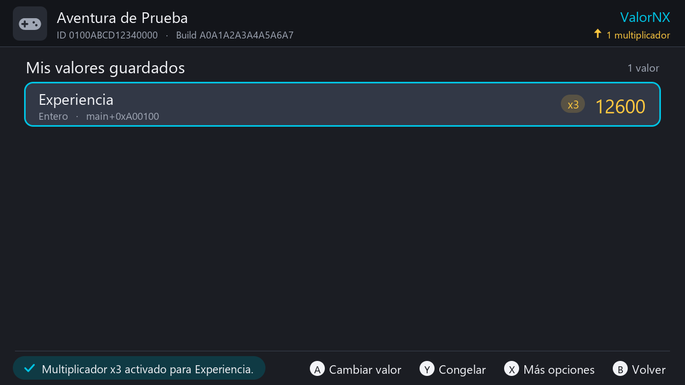
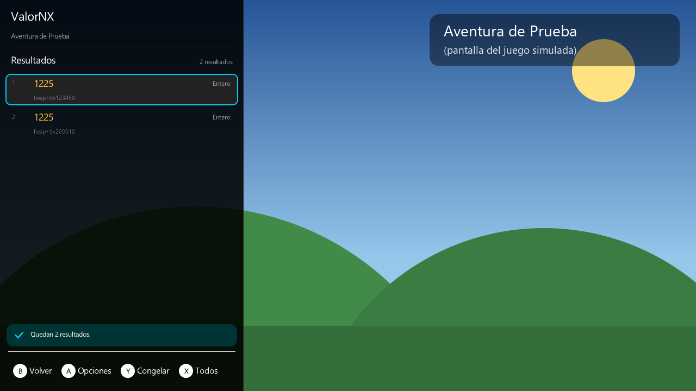

# ValorNX

[Español](README.md) · **English**

Value editor for Nintendo Switch games running on **Atmosphère**. Find your money, health, experience or anything else in the game's memory, then change it, freeze it, multiply what you earn, or save it for next time. It comes as a homebrew app and as a **Tesla / Ultrahand overlay**, so you can also do everything on top of the game without leaving it.

ValorNX talks to the same Atmosphère cheat service that EdiZon and Breeze use (`dmnt:cht`). The difference is that you search for the value yourself in *your* version of the game, so you don't depend on downloaded cheats that may not match your version.

> The interface is in Spanish. This guide quotes every menu with its Spanish label in **bold**, followed by an English translation.

| App | Overlay |
|---|---|
|  |  |
|  |  |
|  |  |

*(Screenshots from the PC simulator, with a made-up game.)*

## Contents

- [What it can do](#what-it-can-do)
- [Requirements](#requirements)
- [Installation](#installation)
- [Quick start](#quick-start)
- [Opening the app](#opening-the-app)
- [Home screen](#home-screen)
- [Value types](#value-types)
- [The number pad](#the-number-pad)
- [Searching](#searching)
- [Continuing a search](#continuing-a-search)
- [Results](#results)
- [Changing and freezing values](#changing-and-freezing-values)
- [My saved values](#my-saved-values)
- [Gain multiplier](#gain-multiplier)
- [Atmosphère cheats](#atmosphère-cheats)
- [Settings and help](#settings-and-help)
- [The overlay](#the-overlay)
- [Buttons](#buttons)
- [Do my values survive closing the game?](#do-my-values-survive-closing-the-game)
- [Tips and troubleshooting](#tips-and-troubleshooting)
- [Files it creates](#files-it-creates)
- [Building](#building)
- [Project structure](#project-structure)
- [Credits](#credits)
- [License](#license)

## What it can do

- **Search for a value you can see** (money, experience, level, ammo…): type the number shown on screen, make it change in the game, type the new number, and repeat until only the right address is left.
- **Search between two numbers**: when you don't know the exact number (for example, health is somewhere between 20 and 100).
- **Search for a hidden value** (health or energy bars with no number): ValorNX saves a copy of the game's memory and then you tell it whether the value *increased*, *decreased*, *changed* or *didn't change*.
- **Change** any value with a big number pad and quick values (99, 999, 9999, 99999).
- **Freeze** a value so the game can't change it (infinite health or ammo). It stays frozen even after you close ValorNX, until you close the game.
- **Change all** the remaining results at once when you can't tell which one is right.
- **Multiply what you earn** (x2, x3, x5, x10 or any number up to 1000): every time the value goes up (EXP, money…), the increase is multiplied. It keeps working while you play, even with ValorNX closed.
- **My saved values**: save what you find under a name ("Money", "Health"…) and change it in seconds next time.
- **Create an Atmosphère cheat** from a saved value, to turn it on from EdiZon or Breeze or load it every time the game starts.
- **Overlay** for Tesla Menu / Ultrahand: search, change, freeze and multiply on top of the game. The search is shared with the app: start it in one and continue in the other.
- The search is **saved on the microSD automatically**: you can go back to the game, close ValorNX and continue later.
- Works with buttons and the touch screen.

## Requirements

- A Nintendo Switch running **Atmosphère** (custom firmware) and the homebrew menu (hbmenu, opened from the Album).
- For the overlay: **nx-ovlloader** plus **Ultrahand** or **Tesla Menu**. If you already use other overlays (sys-clk, EdiZon…), you already have them.
- Use it **offline only**, and back up your saves first.

## Installation

The compiled files (`ValorNX-SD.zip`, or `ValorNX.nro` and `ValorNX.ovl` separately) are in the repository's **Releases** section. You can also build them yourself (see [Building](#building)).

- Easiest: extract `ValorNX-SD.zip` to the **root** of the microSD. It contains both files in the right folders.
- Or copy them by hand:
  - App: `sd:/switch/ValorNX/ValorNX.nro`
  - Overlay: `sd:/switch/.overlays/ValorNX.ovl`

To update, replace both files. Your saved values and your current search are kept.

## Quick start

1. Open the game you want to modify and look at the number (for example, 1500 coins).
2. Press **HOME**, open the **Album** to get the homebrew menu, and start **ValorNX**.
3. Choose **Buscar un valor que ves** ("Search for a value you can see") and type `1500`.
4. Go back to the game and make the number change (buy something, earn EXP…).
5. Back in ValorNX: **Continuar la búsqueda** → **Buscar el nuevo valor** ("Search for the new value") and type the new number.
6. Repeat until few results are left. Open **Ver resultados** ("View results") to change, freeze or save the value.

With the overlay it's even quicker: open it on top of the game, go to the **Buscar** ("Search") tab and do the same steps without leaving the game (see [The overlay](#the-overlay)).

## Opening the app

- Open the game first, press **HOME**, open the **Album** and choose ValorNX in the homebrew menu.
- **Don't** open it by holding **R** while launching a game. That starts ValorNX *instead of* the game (application mode), so there is nothing to read. ValorNX detects this and tells you.
- If no game is open you'll see **No hay ningún juego abierto** ("No game is open"). Open a game and press **A** (**Reintentar**, "Retry"). **Y** shows the built-in guide and **+** exits.
- The top bar shows the game's icon and name, its Title ID and Build ID, and how many values are frozen or multiplied right now.
- If you close the game while ValorNX is open, it notices within a few seconds and goes back to the "no game" screen.

## Home screen

| Option | What it does |
|---|---|
| **Buscar un valor que ves** ("Search for a value you can see") | New search for an exact number. |
| **Buscar entre dos números** ("Search between two numbers") | New search for anything between a minimum and a maximum. |
| **Buscar un valor oculto** ("Search for a hidden value") | New search without a number: saves a snapshot of the memory. |
| **Continuar la búsqueda** ("Continue the search") | Shows the search in progress: step and number of results. |
| **Mis valores guardados** ("My saved values") | Your saved values for this game, with their current value. |
| **Ajustes y ayuda** ("Settings and help") | Search zone, built-in guide, delete the search, version info. |

Starting a new search when one is already in progress asks for confirmation, because the old one is deleted. Press **+** on this screen to exit.

## Value types

Games store numbers in different formats. When you start a search you choose the type with **L / R** on the number pad (in the overlay, with the selector under the pad):

| Type | Use it for |
|---|---|
| **Automático** ("Automatic", recommended) | Searches 4-byte integers and decimals at the same time. Use it if you're not sure. |
| **Entero (4 bytes)** ("Integer") | The most common: money, experience, points, items. |
| **Decimal (float)** | Health or energy in action games, speeds, timers. |
| **Entero pequeño (2 bytes)** ("Small integer") | Stats or items in some games (max 65,535). |
| **Byte (1 byte)** | Small amounts (max 255). Gives a huge number of results. |
| **Entero grande (8 bytes)** ("Big integer") | Huge amounts, for example money over 2 billion. |
| **Decimal doble (double)** | Uncommon. Some games use it for money or time. |

The type is fixed for the rest of that search. ValorNX remembers the last type you used.

Decimal numbers on screen are usually rounded, so decimal searches accept a margin of one unit in the last digit you type: `87` finds anything above 86 and below 88, and `87.5` finds anything above 87.4 and below 87.6.

## The number pad

- **A**: press the selected key. You can also tap the keys.
- **B**: delete the last digit. If there's nothing to delete, go back.
- **X**: clear everything. **Y**: change the sign (+/-).
- **L / R**: change the value type (when starting a search).
- **+**: accept (same as **OK**).
- **Valores rápidos** ("Quick values") when changing a value: 99, 999, 9999 and 99999.
- The "." key only works if the type allows decimals.
- When changing a value, the pad starts with the current value highlighted. The first digit you type replaces it.
- Two boxes when searching between two numbers: **Desde** ("From") and **Hasta** ("To"). **+** or **OK** on "From" moves to "To" (the key reads **Siguiente**, "Next"). **ZL / ZR** or a tap switch boxes, and **B** on an empty "To" box goes back to "From". The order doesn't matter: if you type them backwards, they're swapped.
- If the number doesn't fit the chosen type (too big, or decimals in an integer type), a message in red explains why.

## Searching

### Search for a value you can see

For numbers shown on screen: money, EXP, level, ammo, items…

1. Choose **Buscar un valor que ves** and type the exact number you see. Choose the type (Automático works for most games).
2. ValorNX scans the game's memory with a progress bar (**B** cancels) and tells you how many results it found.
3. Go back to the game (HOME) and make the number change: spend, earn, take damage…
4. Back in ValorNX: **Continuar la búsqueda** → **Buscar el nuevo valor** and type the new number.
5. Repeat until few results are left, then open **Ver resultados**.

### Search between two numbers

When you can't see the exact number, for example health shown as a bar with marks, or a stat you only know approximately.

1. Choose **Buscar entre dos números** and type a minimum ("Desde") and a maximum ("Hasta"), for example 20 and 100.
2. Go back to the game and make the value change.
3. In **Continuar la búsqueda** choose **Aumentó** ("Increased") or **Disminuyó** ("Decreased"), or narrow it down with another, smaller range using **Está entre dos números** ("It's between two numbers"). That option also works in the other kinds of search.

- The first range can't include 0, because memory is full of zeros. Start at 1.
- The smaller the range, the fewer the results. If you know whether it's an integer or a decimal, pick that type instead of Automático.
- If the range would give far too many results, ValorNX warns you early instead of filling the microSD.
- For decimals, each end gets the same rounding margin as an exact search (see [Value types](#value-types)): a range from 80 to 90 accepts anything above 79 and below 91.

### Search for a hidden value

For health or energy bars and anything else without a visible number.

1. Choose **Buscar un valor oculto** and the type (Automático, or Decimal for most health bars). ValorNX saves a copy of the game's memory on the microSD. Depending on the game this can take from hundreds of MB to about 3 GB, and it takes a while.
2. Go back to the game and make the bar change (take damage, use energy…).
3. In ValorNX choose **Disminuyó** ("Decreased"), **Aumentó** ("Increased") or **Cambió** ("Changed", when you don't know which way it went).
4. Keep going: change the value again and choose what happened, or choose **No cambió** ("Didn't change") when it stayed the same, to discard results.
5. When few results are left, open **Ver resultados**.

If the microSD doesn't have enough free space, ValorNX tells you how much is needed. Switch the search zone to **Solo heap** in Settings to make the copy smaller.

## Continuing a search

**Continuar la búsqueda** shows the search type, the step you're on, the number of results (or how much memory was saved) and the last thing you typed, with a tip about what to do next. The options are:

| Option | What it does |
|---|---|
| **Ver resultados (N)** ("View results") | Opens the results when there are 100 or fewer. With more, it becomes **Ver los primeros 100** ("View the first 100"). |
| **Buscar el nuevo valor** ("Search for the new value") | Type the number the game shows now. It's called **Ahora veo el número** ("Now I can see the number") in hidden and range searches. |
| **Disminuyó** ("Decreased") | Keeps the values that went down since the last step. |
| **Aumentó** ("Increased") | Keeps the values that went up. |
| **Cambió** ("Changed") | Keeps the values that changed, up or down. |
| **No cambió** ("Didn't change") | Keeps the values that stayed the same. |
| **Está entre dos números** ("It's between two numbers") | Keeps the values that are now inside a range you type. |
| **Deshacer el último paso** ("Undo last step") | Goes back one step, for example if you typed a wrong number. |
| **Empezar de nuevo** ("Start over") | Deletes the search (asks first). |

- The search is saved on the microSD after every step. If you close ValorNX and open it again while the **same game session** is running, it continues where you left off (**Se recuperó tu búsqueda anterior**, "Your previous search was recovered"). If you restart the game, addresses change, so the search starts from scratch.
- If a step leaves no results, the value may be of another type or the number wasn't exact. Undo and try again.
- A search is limited to 40 million results (about 640 MB on the microSD). If a value is very common (0, 1…), ValorNX asks you to change it in the game to a rarer number and search again.

## Results


The list shows up to 100 results. For each one you see the **address** (memory zone plus offset, for example `heap+0x123450`), the **type**, the **current value** (updated live) and the value it had in the last step (**Antes**, "Before").

- **A**: options for that result:
  - **Cambiar valor** ("Change value"): type a new number.
  - **Congelar / Descongelar** ("Freeze / Unfreeze").
  - **Guardar en Mis valores** ("Save to My values"): asks for a name.
  - **Multiplicar lo que ganes (x2, x3…)** ("Multiply what you earn"): saves the value and sets up a multiplier. Integers only.
  - **Quitar de la lista** ("Remove from list"): discards that result.
- **Y**: freeze or unfreeze the selected result.
- **X**: **Cambiar todos** ("Change all"): writes the same number into every result shown. Useful when several results are left and you don't know which one is right.
- **B**: back.

If several results are left, change one at a time and check which one affects the game. Some games keep a copy of the value just for display: if you change it and the screen doesn't update, spend or earn something so the game refreshes it.

## Changing and freezing values

- **Change**: the number pad opens with the current value. Type the new one and press **+** or **OK**. Quick values (99, 999, 9999, 99999) are there for the usual "max it out".
- **Freeze**: Atmosphère rewrites the value 12 times per second, so the game can't change it (infinite health, ammo, money…). It stays frozen even if you close ValorNX, until you close the game, or until you unfreeze it from ValorNX, EdiZon or Breeze. The top bar shows how many values are frozen.
- If you change a frozen value, it's frozen again at the new number.

## My saved values


Each game has its own list, saved on the microSD. Each value is stored relative to its memory zone (`main`, `heap`…), so it still works when the base address changes.

**Naming a value**: pick a name from the list (**Dinero** "Money", **Vida** "Health", **Vida máxima** "Max health", **Experiencia** "Experience", **Nivel** "Level", **Magia / Maná** "Magic / Mana", **Munición** "Ammo", **Objetos** "Items", **Puntos** "Points", **Tiempo** "Time"), or choose **Escribir otro nombre…** ("Type another name") to use the system keyboard. Repeated names get a number ("Money 2").

Each row shows the name, type, zone, current value and badges: a snowflake if it's frozen, **x3** (gold) if it has an active multiplier, or **x3 en pausa** ("paused", grey). **Guardado en otra versión del juego** ("Saved in another game version", in red) means you saved it in a different version (Build ID) of the game, so it may point to the wrong place.

- **A**: **Cambiar valor** ("Change value"). The number you type is also remembered as that value's "last value".
- **Y**: freeze / unfreeze.
- **X**: **Más opciones** ("More options"):
  - **Multiplicar lo que ganes (x2, x3…)**, or, if it already has one, **Multiplicador xN (activo / en pausa)** to change, pause/resume or remove it. See [Gain multiplier](#gain-multiplier).
  - **Cambiar el nombre** ("Rename").
  - **Crear truco de Atmosphère** ("Create Atmosphère cheat"). See [Atmosphère cheats](#atmosphère-cheats).
  - **Borrar de Mis valores** ("Delete from My values"): only removes it from the list; the game doesn't change. It also unfreezes it and removes its multiplier.

## Gain multiplier

Makes you earn more: every time the value goes **up**, the increase is multiplied.

1. Find the value (for example, your experience) and save it.
2. In **Ver resultados** press **A** → **Multiplicar lo que ganes**, or in **Mis valores** press **X** → **Multiplicar lo que ganes**.
3. Choose **x2** ("double"), **x3** ("triple"), **x5**, **x10** or **Otro número…** ("Other number", from 2 to 1000).
4. Choose how to turn it on. Do it **once you're in your save**, not on the title screen:
   - **Activar ahora** ("Turn on now"): lasts until you close the game.
   - **Activar y guardar como truco** ("Turn on and save as cheat"): also saves it to the game's cheat file, so it's loaded every time you start the game. For values outside `main`, it only works if the value is still at the same address after restarting.

How it works: ValorNX creates a program for Atmosphère's cheat engine, which runs 12 times per second while the game is open. If the value went up since last time, it adds the increase multiplied by (factor − 1). If it went down (when you spend), it does nothing. To remember the previous value it uses 8 free bytes at the end of the game executable's memory (after its `.bss`).

- From **Mis valores** you can change the factor, pause it (**Pausar**), resume it (**Reanudar**) or remove it (**Quitar el multiplicador**). What you earn while it's paused isn't multiplied. You can also see and switch it off from EdiZon or Breeze.
- Removing it also deletes it from the cheat file if it was saved there.
- **Integers only**, not decimals. There's a cap so the value can't overflow.
- Up to 16 multipliers per game, depending on free space. If there's no room left, remove one you don't use.
- If your game resets EXP to 0 on level-up, the gain that levels you up isn't multiplied, because the cheat sees the value going down.
- If the value passes through 0 (for example on the title screen), whatever loads afterwards isn't multiplied. That's why you should turn it on once you're playing.
- If the number goes crazy, you probably multiplied a copy the game uses to animate the counter. Remove the multiplier and try another result.

## Atmosphère cheats

**Mis valores** → **X** → **Crear truco de Atmosphère** ("Create Atmosphère cheat") turns a saved value into a normal Atmosphère cheat:

1. Type the fixed value the cheat should write. It starts with the last value you set, or the current one.
2. ValorNX writes it to `sd:/atmosphere/contents/<TitleID>/cheats/<BuildID>.txt`, named after the value (for example `Dinero = 99999`), and loads it right away, turned off.
3. Turn it on from **EdiZon** or **Breeze** whenever you want. It's also loaded every time you start the game.

If it stops working after restarting the game, the value moved: search for it again.

## Settings and help

**Ajustes y ayuda** ("Settings and help") has:

- **Zona de búsqueda** ("Search zone"). Press A to cycle through:
  - **Toda la memoria (recomendado)** ("All memory", recommended): all of the game's writable data.
  - **Solo heap (datos dinámicos)** ("Heap only", dynamic data): less memory, faster, and a smaller copy for hidden-value searches. Most values live here.
  - **Solo main (datos fijos del juego)** ("Main only", the game's fixed data): the executable's own data. Values here usually stay at the same address every time you start the game.
- **Cómo se usa** ("How to use"): the built-in step-by-step guide (scroll with the D-pad, **L / R** jump a page).
- **Borrar la búsqueda en curso** ("Delete the current search"): frees the space it uses on the microSD.
- **Acerca de ValorNX** ("About"): version and a short description.

## The overlay

The overlay (`ValorNX.ovl`) does the same as the app, **on top of the game**, without going through HOME and the Album.

### Opening it

1. While you play, open the overlay menu with its button combination and choose **ValorNX**.
   - Ultrahand's default combo is **ZL + ZR + D-pad down**, and Tesla's is **L + D-pad down + R3**. Many CFW packs change it (for example to **ZL + ZR + L + R**). Yours is the `key_combo=` line in `sd:/config/ultrahand/config.ini`.
   - With Ultrahand in handheld mode you can also open it by swiping in from the left edge of the screen.
   - Tip: in Ultrahand's list, press **Y** on ValorNX and give it its own combo (**Key Combo**) to open it directly.
2. At the top there are two tabs, **Mis valores** and **Buscar**. Switch with the **D-pad left / right**, or tap them.
3. **B** on the main page closes the overlay. Pressing the combo again hides it, and the next time it opens straight into ValorNX.

### "Mis valores" tab (My values)


Your saved values for the running game, with their current value (updated live) and whether they're frozen (snowflake) or multiplied (**xN**).

- **A**: change the value (number pad with quick values 99, 999, 9999, 99999).
- **Y**: freeze / unfreeze.
- **X**: more options: change, freeze, and the multiplier (x2, x3, x5, x10), plus pause/resume, change or remove it if it has one. A multiplier turned on from the overlay lasts until you close the game. If that value's multiplier was already saved as a cheat, the new one is saved too.
- If you have no saved values yet, **A** takes you to the Buscar tab.

### "Buscar" tab (Search)


The same three searches as the app: **Buscar un valor que ves**, **Buscar entre dos números** and **Buscar un valor oculto**.

1. Choose the search and type the number. Choose the value type in the selector under the pad: select it with the D-pad and change it with **left / right**, or tap its arrows.
2. A progress bar appears (**B** cancels). **Don't close the overlay until it finishes**, or that search is cancelled (you'll see a notice next time you open it).
3. Close the overlay (**B**), play so the value changes, and open it again: the search waits for you in the Buscar tab.
4. Choose **Buscar el nuevo valor**, **Aumentó**, **Disminuyó**, **Cambió**, **No cambió** or **Está entre dos números**, just like in the app. You also have **Deshacer el último paso** (undo) and **Empezar de nuevo** (start over).
5. Open **Ver resultados**:
   - **A**: options: change value, freeze, **Guardar en Mis valores** (save), multiply what you earn, remove from list.
   - **Y**: freeze. **X**: **Todos** (change all). **B**: back.
   - When saving you pick the name from a list (Dinero, Vida, Experiencia…, or **Valor** for a generic "Value 1, Value 2…"). Overlays can't open the letter keyboard; rename it later in the app if you want.


### Good to know

- **The search and the saved values are the same in the app and the overlay.** You can start a search in one and continue it in the other. Changes from the overlay show up in the app within a couple of seconds, and vice versa.
- The overlay only has 4 MB of memory for everything, so it searches in small blocks. It takes a bit longer than the app but finds exactly the same results. It needs about 200–350 KB while searching. Ultrahand's settings can raise the overlay memory to 6 or 8 MB, but it isn't necessary.
- A hidden-value search copies the game's memory to the microSD and may take a couple of minutes in big games.
- **The overlay can't open the app.** The system only lets the HOME menu or a game open the Album (where the homebrew menu lives), not an overlay. For the app-only features (creating cheats, settings, renaming a value), open ValorNX from the Album as usual.
- Atmosphère only allows two programs connected to its cheat service at the same time. The overlay connects only while it's visible, but if you have the app and another cheat tool (EdiZon, Breeze) open, close one of them.

## Buttons

**App**

| Button | Action |
|---|---|
| A | Accept / choose |
| B | Back (on the number pad: delete) |
| X / Y | Per-screen options (in results: Y freezes, X changes all) |
| L / R | Change the value type on the number pad; jump a page in the help |
| ZL / ZR | Switch between "From" and "To" in range searches |
| + | Accept on the number pad / exit on the home screen |
| Touch screen | Tap any option or key, and drag lists to scroll |

**Overlay**

| Button | Action |
|---|---|
| D-pad left / right | Switch tabs (Mis valores / Buscar). On the number pad: move, or change the type when the type selector is selected |
| A | Choose / change the value |
| B | Back. On the main page: close the overlay. While searching: cancel |
| Y | Freeze / unfreeze |
| X | More options (Mis valores), change all (results) |
| + | Accept on the number pad |

## Do my values survive closing the game?

Yes, **your saved values are never deleted**: they stay in Mis valores (and in the overlay). But each value is stored relative to its memory zone:

- Values in **`main`** are usually at the same address every time you start the game.
- Values in **`heap`** sometimes move when you restart the game.

When you start the game again, check in Mis valores (or the overlay) that the number matches the game. If you see a strange number, that value moved: search for it again and save it again. For the same reason, before saving a `heap` value as a cheat (or using "Activar y guardar como truco" on a multiplier), check that it's still at the same address after restarting the game.

The **search in progress**, however, only lasts while the same game session is running. If you close the game, the next search starts from scratch.

## Tips and troubleshooting

- **Back up your save** (for example with JKSV) before changing values.
- **Don't use it in online games**: you can get banned.
- **Nothing found?** Use the **Automático** type and make sure you type the exact number. Health in action games is often **Decimal**.
- **Several results?** Change one at a time and see which one affects the game, or use **Cambiar todos** ("Change all").
- **The screen doesn't update after a change?** Some games show a copy of the value: spend or earn something so it refreshes.
- **"Too many results"**: the value is very common. Change it in the game to a rarer number and search again, or use a smaller range or a specific type.
- **Not enough space for a hidden-value search**: free up space or set the search zone to **Solo heap** in Settings.
- **"ValorNX se abrió en lugar de un juego"** ("ValorNX opened instead of a game"): you started it by holding R on a game. Close it, open your game normally, press HOME and open ValorNX from the Album.
- **"No se pudo conectar con el servicio de trucos de Atmosphère (dmnt:cht)"** ("Couldn't connect to Atmosphère's cheat service"): update Atmosphère, and close EdiZon/Breeze if they're open.
- **The overlay doesn't show up**: check your overlay menu's combo (see [The overlay](#the-overlay)) and that `ValorNX.ovl` is in `sd:/switch/.overlays/`.
- **A saved value shows "Guardado en otra versión del juego"**: the game was updated, so the address may have changed. Search for it again.

## Files it creates

```
sd:/switch/ValorNX/config.txt                          settings (search zone, last value type)
sd:/switch/ValorNX/guardados/<TitleID>.txt             your saved values for each game
sd:/switch/ValorNX/busqueda/                           search in progress (deleted when you start another)
sd:/atmosphere/contents/<TitleID>/cheats/<BuildID>.txt cheats you create and multipliers saved as cheats
```

## Building

The project uses devkitPro (devkitA64 + libnx + switch-freetype + switch-libjpeg-turbo). The overlay uses libtesla, included in `overlay/libtesla/`.

```bash
make               # the app: ValorNX.nro
make -C overlay    # the overlay: overlay/ValorNX.ovl
```

`build.sh` does the same inside WSL, with devkitPro installed in a separate Debian environment (`/opt/dkp-root`): `wsl -d Ubuntu -u root -- bash ./build.sh`. `bash ./build.sh clean` deletes the build output.

### PC tests

The `pc/` folder builds the same code against a simulated game (Linux/WSL, needs g++, FreeType and zlib):

```bash
cd pc
make test          # tests for the search engine, cheats, multiplier and saved values
bash run_sim.sh    # runs the app and the overlay from scripts and saves screenshots to pc/shots/
```

The overlay is drawn on PC by an emulator of libtesla's renderer (the same 448x720 layer with 4 bits per channel and the same stb_truetype text), so the screenshots look like the console. The `overlay_buscar.txt` script also measures how much memory the overlay asks for while searching.

## Project structure

```
source/core/     engine: value types, search and refine, saved values, cheats,
                 freeze and multiply (shared by the app and the overlay)
source/ui/       app interface: software drawing, FreeType text, icons, screens
source/overlay/  overlay: panel and its pages (no libtesla dependency) and libtesla startup
source/switch/   Switch side: dmnt:cht client, game access, the app's main
overlay/         overlay Makefile and libtesla
pc/              simulated game, tests, libtesla emulator and simulator
docs/img/        screenshots for this README
```

## Credits

- The `dmnt:cht` service protocol comes from [Atmosphère](https://github.com/Atmosphere-NX/Atmosphere).
- The overlay uses [libtesla](https://github.com/WerWolv/libtesla) by WerWolv (GPLv2, included in `overlay/libtesla/LICENSE`), with stb_truetype (public domain).
- Inspired by EdiZon and Breeze.

## License

ValorNX is released under the **GPL v2** license (see [`LICENSE`](LICENSE)), the same as libtesla, which the overlay uses.
