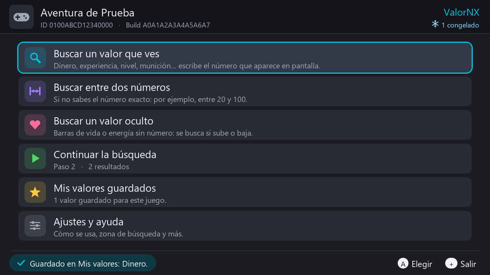
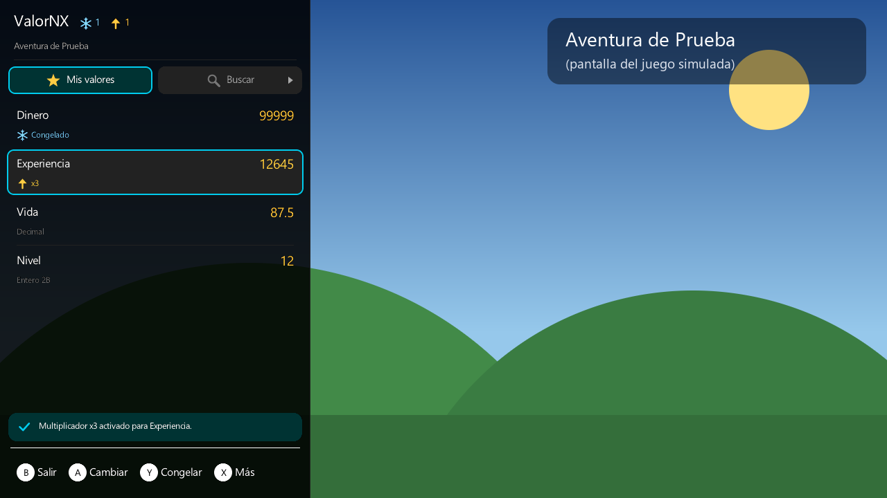
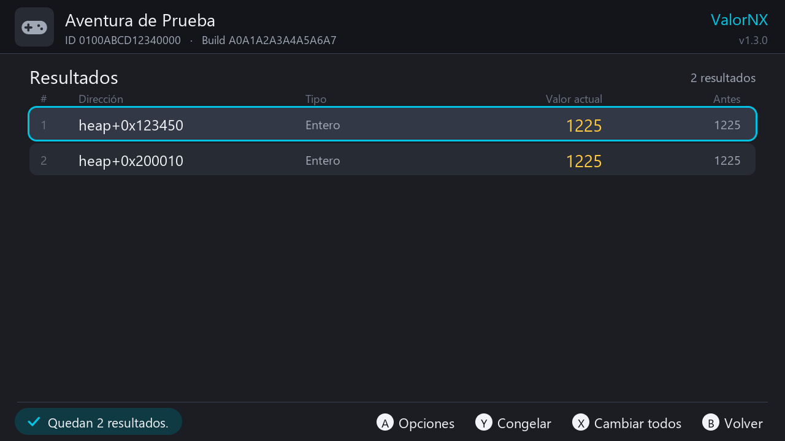
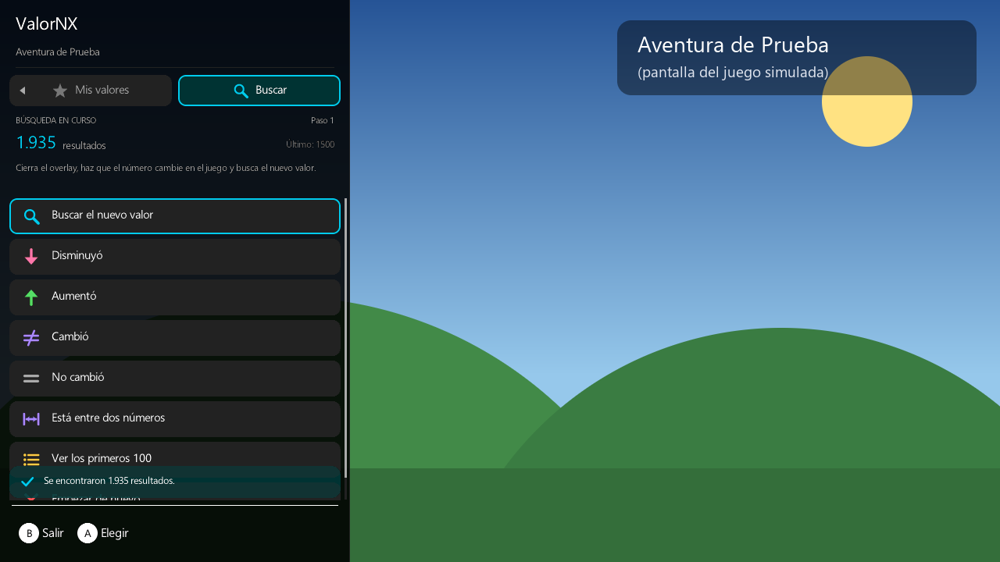
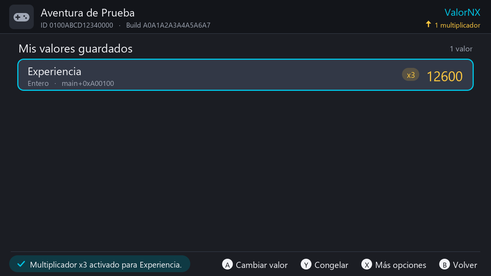
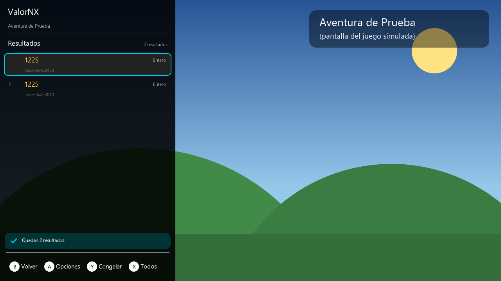

# ValorNX

**Español** · [English](README.en.md)

Editor de valores para juegos de Nintendo Switch con **Atmosphère**. Busca en la memoria del juego el dinero, la vida, la experiencia o lo que quieras, y cámbialo, congélalo, multiplica lo que ganas o guárdalo para la próxima vez. Viene como app del menú homebrew y como **overlay de Tesla / Ultrahand**, para hacerlo todo también encima del juego, sin salir de él.

Funciona con el mismo servicio de trucos de Atmosphère que usan EdiZon y Breeze (`dmnt:cht`). La diferencia es que tú mismo buscas el valor en *tu* versión del juego, así que no dependes de trucos descargados que no coinciden con tu versión.

| App | Overlay |
|---|---|
|  |  |
|  |  |
|  |  |

*(Capturas del simulador de PC, con un juego inventado.)*

## Contenido

- [Qué hace](#qué-hace)
- [Requisitos](#requisitos)
- [Instalación](#instalación)
- [Empezar rápido](#empezar-rápido)
- [Abrir la app](#abrir-la-app)
- [Menú principal](#menú-principal)
- [Tipos de valor](#tipos-de-valor)
- [El teclado numérico](#el-teclado-numérico)
- [Buscar](#buscar)
- [Continuar la búsqueda](#continuar-la-búsqueda)
- [Resultados](#resultados)
- [Cambiar y congelar valores](#cambiar-y-congelar-valores)
- [Mis valores guardados](#mis-valores-guardados)
- [Multiplicar lo que ganes](#multiplicar-lo-que-ganes)
- [Trucos de Atmosphère](#trucos-de-atmosphère)
- [Ajustes y ayuda](#ajustes-y-ayuda)
- [El overlay](#el-overlay)
- [Botones](#botones)
- [¿Mis valores siguen ahí si cierro el juego?](#mis-valores-siguen-ahí-si-cierro-el-juego)
- [Consejos y problemas comunes](#consejos-y-problemas-comunes)
- [Archivos que crea](#archivos-que-crea)
- [Compilar](#compilar)
- [Estructura](#estructura)
- [Créditos](#créditos)
- [Licencia](#licencia)

## Qué hace

- **Buscar un valor que ves** (dinero, experiencia, nivel, munición…): escribes el número que aparece en pantalla, haces que cambie en el juego, escribes el nuevo y repites hasta quedarte con la dirección correcta.
- **Buscar entre dos números**: cuando no sabes el número exacto (por ejemplo, la vida está entre 20 y 100).
- **Buscar un valor oculto** (barras de vida o energía sin número): se guarda una copia de la memoria y luego eliges si el valor *aumentó*, *disminuyó*, *cambió* o *no cambió*.
- **Cambiar** cualquier valor con un teclado numérico grande y valores rápidos (99, 999, 9999, 99999).
- **Congelar** un valor para que el juego no pueda cambiarlo (vida o munición infinitas). Sigue congelado aunque cierres ValorNX, hasta que cierres el juego.
- **Cambiar todos** los resultados que queden a la vez, cuando no sabes cuál es el bueno.
- **Multiplicar lo que ganes** (x2, x3, x5, x10 o el número que quieras hasta 1000): cada vez que el valor sube (EXP, dinero…), la subida se multiplica. Sigue funcionando mientras juegas, aunque cierres ValorNX.
- **Mis valores**: guarda lo que encuentres con un nombre ("Dinero", "Vida"…) para cambiarlo en segundos la próxima vez.
- **Crear un truco de Atmosphère** con un valor guardado, para activarlo desde EdiZon o Breeze o que se cargue cada vez que abras el juego.
- **Overlay** para Tesla Menu / Ultrahand: busca, cambia, congela y multiplica encima del juego. La búsqueda es la misma que la de la app: puedes empezarla en uno y seguirla en el otro.
- La búsqueda **se guarda sola en la microSD**: puedes volver al juego, cerrar ValorNX y continuar después.
- Funciona con botones y con la pantalla táctil.

## Requisitos

- Switch con **Atmosphère** (CFW) y el menú homebrew (hbmenu, se abre desde el Álbum).
- Para el overlay: **nx-ovlloader** con **Ultrahand** o **Tesla Menu**. Si ya usas otros overlays (sys-clk, EdiZon…), ya los tienes.
- Úsalo **solo sin conexión** y haz copia de tu partida antes.

## Instalación

Los archivos ya compilados (`ValorNX-SD.zip`, o `ValorNX.nro` y `ValorNX.ovl` por separado) están en la sección **Releases** del repositorio. También puedes compilarlos tú (ver [Compilar](#compilar)).

- Lo más fácil: descomprime `ValorNX-SD.zip` en la **raíz** de la microSD. Trae los dos archivos en sus carpetas.
- O cópialos a mano:
  - App: `sd:/switch/ValorNX/ValorNX.nro`
  - Overlay: `sd:/switch/.overlays/ValorNX.ovl`

Para actualizar, reemplaza los dos archivos. Tus valores guardados y la búsqueda en curso se conservan.

## Empezar rápido

1. Abre el juego que quieres modificar y fíjate en el número (por ejemplo, 1500 monedas).
2. Pulsa **HOME**, abre el **Álbum** para entrar al menú homebrew y abre **ValorNX**.
3. Elige **Buscar un valor que ves** y escribe `1500`.
4. Vuelve al juego y haz que el número cambie (compra algo, gana experiencia…).
5. Vuelve a ValorNX: **Continuar la búsqueda** → **Buscar el nuevo valor** y escribe el número nuevo.
6. Repite hasta que queden pocos resultados. Entra en **Ver resultados** para cambiar, congelar o guardar el valor.

Con el overlay es aún más rápido: ábrelo encima del juego, ve a la pestaña **Buscar** y haz lo mismo sin salir del juego (ver [El overlay](#el-overlay)).

## Abrir la app

- Primero abre el juego, pulsa **HOME**, abre el **Álbum** y elige ValorNX en el menú homebrew.
- **No** lo abras manteniendo **R** al lanzar un juego: así ValorNX se abre *en lugar* del juego (modo aplicación) y no hay nada que leer. ValorNX lo detecta y te lo explica.
- Si no hay ningún juego abierto verás **No hay ningún juego abierto**. Abre un juego y pulsa **A** (**Reintentar**). **Y** abre la guía y **+** sale.
- Arriba se ven el icono y el nombre del juego, su Title ID y su Build ID, y cuántos valores hay congelados o multiplicados ahora mismo.
- Si cierras el juego con ValorNX abierto, lo nota en unos segundos y vuelve a la pantalla de "no hay juego".

## Menú principal

| Opción | Qué hace |
|---|---|
| **Buscar un valor que ves** | Búsqueda nueva de un número exacto. |
| **Buscar entre dos números** | Búsqueda nueva de todo lo que esté entre un mínimo y un máximo. |
| **Buscar un valor oculto** | Búsqueda nueva sin número: se guarda una foto de la memoria. |
| **Continuar la búsqueda** | La búsqueda en curso: en qué paso vas y cuántos resultados quedan. |
| **Mis valores guardados** | Tus valores guardados de este juego, con su valor actual. |
| **Ajustes y ayuda** | Zona de búsqueda, guía, borrar la búsqueda y versión. |

Si empiezas una búsqueda nueva con otra en curso, te pide confirmación porque se borra la anterior. En esta pantalla, **+** sale de ValorNX.

## Tipos de valor

Los juegos guardan los números en formatos distintos. Al empezar una búsqueda eliges el tipo con **L / R** en el teclado (en el overlay, con el selector de debajo del teclado):

| Tipo | Para qué |
|---|---|
| **Automático** (recomendado) | Busca enteros de 4 bytes y decimales a la vez. Úsalo si no sabes cuál elegir. |
| **Entero (4 bytes)** | El más común: dinero, experiencia, puntos, objetos. |
| **Decimal (float)** | Vida o energía en juegos de acción, velocidades, tiempos. |
| **Entero pequeño (2 bytes)** | Estadísticas u objetos en algunos juegos (máximo 65.535). |
| **Byte (1 byte)** | Cantidades pequeñas (máximo 255). Da muchísimos resultados. |
| **Entero grande (8 bytes)** | Cantidades enormes, por ejemplo dinero de más de 2.000 millones. |
| **Decimal doble (double)** | Poco común. Algunos juegos lo usan para dinero o tiempo. |
| **Port de Wii U o GameCube** | Para juegos de Wii U o GameCube pasados a Switch, como Wind Waker HD (SwitchWakerHD). Busca enteros de 2 y 4 bytes y decimales a la vez. |

El tipo ya no cambia mientras sigues esa búsqueda. ValorNX recuerda el último tipo que usaste.

**Ports de Wii U o GameCube.** Algunos ports traducen el código original de la consola en vez de rehacer el juego, y la memoria se queda como en esa consola: los números se guardan **con los bytes al revés** (big-endian). Por ejemplo, 150 rupias son los bytes `00 96`, que leídos como en un juego de Switch dan 38400. Por eso ninguno de los otros tipos los encuentra. Con el tipo **Port de Wii U o GameCube** escribes el número tal como lo ves, y ValorNX le da la vuelta al buscar, al mostrarlo, al cambiarlo y al guardarlo como truco. No lo necesitan los ports hechos a partir del código fuente del juego (como SwitchWaker, el de GameCube, o los de Ocarina of Time y Super Mario 64): ahí los números se guardan normal. El multiplicador no funciona con estos valores.

Los decimales que salen en pantalla suelen estar redondeados, así que al buscar decimales se acepta un margen de una unidad en la última cifra que escribes: `87` encuentra todo lo que esté entre 86 y 88, y `87.5`, entre 87,4 y 87,6.

## El teclado numérico

- **A**: pulsa la tecla marcada. También puedes tocar las teclas.
- **B**: borra la última cifra. Si no hay nada que borrar, vuelve atrás.
- **X**: limpia todo. **Y**: cambia el signo (+/-).
- **L / R**: cambian el tipo de valor (al empezar una búsqueda).
- **+**: acepta (igual que **OK**).
- **Valores rápidos** al cambiar un valor: 99, 999, 9999 y 99999.
- La tecla "." solo funciona si el tipo admite decimales.
- Al cambiar un valor, el teclado empieza con el valor actual marcado: la primera cifra que escribas lo sustituye.
- En la búsqueda entre dos números hay dos casillas, **Desde** y **Hasta**. **+** u **OK** en "Desde" pasa a "Hasta" (la tecla dice **Siguiente**). **ZL / ZR** o un toque cambian de casilla, y **B** con "Hasta" vacía vuelve a "Desde". Da igual el orden: si los escribes al revés, se ordenan solos.
- Si el número no cabe en el tipo elegido (demasiado grande, o con decimales en un tipo entero), un aviso en rojo te dice por qué.

## Buscar

### Buscar un valor que ves

Para números que aparecen en pantalla: dinero, EXP, nivel, munición, objetos…

1. Elige **Buscar un valor que ves** y escribe el número exacto que ves. Elige el tipo (Automático sirve para la mayoría de los juegos).
2. ValorNX recorre la memoria del juego con una barra de progreso (**B** cancela) y te dice cuántos resultados encontró.
3. Vuelve al juego (HOME) y haz que el número cambie: gasta, gana, recibe daño…
4. Vuelve a ValorNX: **Continuar la búsqueda** → **Buscar el nuevo valor** y escribe el número nuevo.
5. Repite hasta que queden pocos resultados y entra en **Ver resultados**.

### Buscar entre dos números

Cuando no ves el número exacto: por ejemplo, la vida es una barra con marcas, o una estadística que solo conoces más o menos.

1. Elige **Buscar entre dos números** y escribe el mínimo ("Desde") y el máximo ("Hasta"). Por ejemplo, 20 y 100.
2. Vuelve al juego y haz que el valor cambie.
3. En **Continuar la búsqueda** elige **Aumentó** o **Disminuyó**, o escribe otro rango más pequeño con **Está entre dos números** (esta opción también sirve en las otras búsquedas).

- El primer rango no puede incluir el 0: en la memoria hay muchísimos ceros. Empieza en 1.
- Cuanto más pequeño sea el rango, menos resultados. Si sabes si es entero o decimal, elige ese tipo en vez de Automático.
- Si el rango va a dar demasiados resultados, ValorNX avisa enseguida en vez de llenar la microSD.
- Con decimales, cada extremo lleva el mismo margen de redondeo que una búsqueda exacta (ver [Tipos de valor](#tipos-de-valor)): un rango de 80 a 90 acepta todo lo que esté por encima de 79 y por debajo de 91.

### Buscar un valor oculto

Para barras de vida o energía y todo lo que no tenga un número a la vista.

1. Elige **Buscar un valor oculto** y el tipo (Automático, o Decimal para la mayoría de las barras de vida). ValorNX guarda una copia de la memoria del juego en la microSD: según el juego ocupa de cientos de MB a unos 3 GB, y tarda un poco.
2. Vuelve al juego y haz que la barra cambie (recibe daño, gasta energía…).
3. En ValorNX elige **Disminuyó**, **Aumentó** o **Cambió** (si no sabes si subió o bajó).
4. Sigue así: haz que el valor cambie otra vez y elige qué pasó, o elige **No cambió** cuando se quede igual, para descartar resultados.
5. Cuando queden pocos, entra en **Ver resultados**.

Si no hay espacio suficiente en la microSD, ValorNX te dice cuánto hace falta. Cambia la zona de búsqueda a **Solo heap** en Ajustes para que la copia ocupe menos.

## Continuar la búsqueda

**Continuar la búsqueda** muestra el tipo de búsqueda, el paso en el que vas, cuántos resultados quedan (o cuánta memoria se guardó) y lo último que escribiste, con un consejo de qué hacer después. Las opciones son:

| Opción | Qué hace |
|---|---|
| **Ver resultados (N)** | Abre los resultados cuando quedan 100 o menos. Con más, sale **Ver los primeros 100 resultados**. |
| **Buscar el nuevo valor** | Escribe el número que muestra ahora el juego. En las búsquedas de valor oculto o entre dos números se llama **Ahora veo el número: escribirlo**. |
| **Disminuyó** | Se queda con los valores que bajaron desde el paso anterior. |
| **Aumentó** | Se queda con los que subieron. |
| **Cambió** | Se queda con los que cambiaron, subieran o bajaran. |
| **No cambió** | Se queda con los que siguen igual. |
| **Está entre dos números** | Se queda con los que ahora están dentro del rango que escribas. |
| **Deshacer el último paso** | Vuelve un paso atrás, por ejemplo si te equivocaste de número. |
| **Empezar de nuevo** | Borra la búsqueda (antes te pregunta). |

- La búsqueda se guarda en la microSD después de cada paso. Si cierras ValorNX y lo abres otra vez con **la misma partida del juego abierta**, sigue donde la dejaste (**Se recuperó tu búsqueda anterior**). Si reinicias el juego, las direcciones cambian y la búsqueda empieza de cero.
- Si un paso deja cero resultados, puede que el valor sea de otro tipo o que el número no fuera exacto: deshaz el paso y prueba otra vez.
- Una búsqueda admite hasta 40 millones de resultados (unos 640 MB en la microSD). Si el valor es muy común (0, 1…), ValorNX te pide que lo cambies en el juego a un número más raro y busques otra vez.

## Resultados


La lista muestra hasta 100 resultados. De cada uno ves la **dirección** (zona de memoria + desplazamiento, por ejemplo `heap+0x123450`), el **tipo**, el **valor actual** (se actualiza solo) y el que tenía en el paso anterior (**Antes**).

- **A**: opciones de ese resultado:
  - **Cambiar valor**: escribe un número nuevo.
  - **Congelar / Descongelar**.
  - **Guardar en Mis valores**: te pide un nombre.
  - **Multiplicar lo que ganes (x2, x3…)**: lo guarda en Mis valores y le pone un multiplicador. Solo con enteros.
  - **Quitar de la lista**: descarta ese resultado.
- **Y**: congela o descongela el resultado marcado.
- **X**: **Cambiar todos**: escribe el mismo número en todos los resultados de la lista. Útil cuando quedan varios y no sabes cuál es el bueno.
- **B**: volver.

Si quedan varios resultados, cambia uno cada vez y mira cuál afecta al juego. Algunos juegos guardan una copia del valor solo para mostrarlo: si lo cambias y en pantalla no se actualiza, gasta o gana algo para que se refresque.

## Cambiar y congelar valores

- **Cambiar**: el teclado se abre con el valor actual. Escribe el nuevo y pulsa **+** u **OK**. Los valores rápidos (99, 999, 9999, 99999) sirven para el clásico "al máximo".
- **Congelar**: Atmosphère vuelve a escribir el valor 12 veces por segundo, así que el juego no puede cambiarlo (vida, munición, dinero infinitos…). Sigue congelado aunque cierres ValorNX, hasta que cierres el juego o lo descongeles desde ValorNX, EdiZon o Breeze. Arriba se ve cuántos valores hay congelados.
- Si cambias un valor congelado, queda congelado con el número nuevo.

## Mis valores guardados


Cada juego tiene su propia lista, guardada en la microSD. Cada valor se guarda relativo a su zona de memoria (`main`, `heap`…), así sigue sirviendo aunque cambie la dirección base.

**Ponerle nombre**: elige uno de la lista (**Dinero**, **Vida**, **Vida máxima**, **Experiencia**, **Nivel**, **Magia / Maná**, **Munición**, **Objetos**, **Puntos**, **Tiempo**) o **Escribir otro nombre…** para usar el teclado de la consola. Si el nombre ya existe se le añade un número ("Dinero 2").

Cada fila muestra el nombre, el tipo, la zona, el valor actual y unas etiquetas: un copo de nieve si está congelado, **x3** (dorado) si tiene un multiplicador activo o **x3 en pausa** (gris). **Guardado en otra versión del juego** (en rojo) significa que lo guardaste en otra versión (Build ID) del juego, así que puede apuntar a otro sitio.

- **A**: **Cambiar valor**. El número que escribas se recuerda como "último valor" de ese valor.
- **Y**: congelar / descongelar.
- **X**: **Más opciones**:
  - **Multiplicar lo que ganes (x2, x3…)**, o, si ya tiene uno, **Multiplicador xN (activo / en pausa)** para cambiarlo, pausarlo, reanudarlo o quitarlo. Ver [Multiplicar lo que ganes](#multiplicar-lo-que-ganes).
  - **Cambiar el nombre**.
  - **Crear truco de Atmosphère**. Ver [Trucos de Atmosphère](#trucos-de-atmosphère).
  - **Borrar de Mis valores**: solo lo quita de la lista, el juego no cambia. También lo descongela y le quita el multiplicador.

## Multiplicar lo que ganes

Para ganar más: cada vez que el valor **sube**, la subida se multiplica.

1. Encuentra el valor (por ejemplo, tu experiencia) y guárdalo.
2. En **Ver resultados** pulsa **A** → **Multiplicar lo que ganes**, o en **Mis valores** pulsa **X** → **Multiplicar lo que ganes**.
3. Elige **x2** (el doble), **x3** (el triple), **x5**, **x10** u **Otro número…** (de 2 a 1000).
4. Elige cómo activarlo, **cuando ya estés dentro de tu partida** (no en la pantalla de título):
   - **Activar ahora**: dura hasta que cierres el juego.
   - **Activar y guardar como truco**: además lo guarda en el archivo de trucos del juego, así se carga cada vez que lo abras. Con valores fuera de `main`, solo funciona si el valor sigue en el mismo sitio al reiniciar.

Cómo funciona: ValorNX crea un programa para el sistema de trucos de Atmosphère, que se ejecuta 12 veces por segundo mientras el juego está abierto. Si el valor subió desde la última vez, le suma la subida multiplicada por (factor − 1). Si bajó (al gastar), no hace nada. Para recordar el valor anterior usa 8 bytes libres que quedan al final de la memoria del ejecutable del juego (tras su `.bss`).

- Desde **Mis valores** puedes cambiar el multiplicador, pausarlo (**Pausar**), reanudarlo (**Reanudar**) o quitarlo (**Quitar el multiplicador**). Lo que ganes mientras está en pausa no se multiplica. También se ve y se puede apagar desde EdiZon o Breeze.
- Al quitarlo también se borra del archivo de trucos, si estaba guardado ahí.
- Solo funciona con números **enteros** (no con decimales ni con valores de ports de Wii U o GameCube) y tiene un tope para no desbordar el valor.
- Hasta 16 multiplicadores por juego, según el espacio libre. Si no quedan huecos, quita alguno que no uses.
- Si en tu juego la experiencia vuelve a 0 al subir de nivel, la ganancia que te hace subir de nivel no se multiplica (el truco ve que el valor bajó).
- Si el valor pasa por 0 (por ejemplo, en la pantalla de título), lo que se cargue después no se multiplica. Por eso conviene activarlo ya dentro de la partida.
- Si el número se descontrola, seguramente multiplicaste una copia que el juego usa para animar el contador: quita el multiplicador y prueba con otro resultado.

## Trucos de Atmosphère

**Mis valores** → **X** → **Crear truco de Atmosphère** convierte un valor guardado en un truco normal de Atmosphère:

1. Escribe el valor fijo que pondrá el truco. Empieza con el último valor que pusiste, o con el actual.
2. ValorNX lo escribe en `sd:/atmosphere/contents/<TitleID>/cheats/<BuildID>.txt` con el nombre del valor (por ejemplo `Dinero = 99999`) y lo carga al momento, desactivado.
3. Actívalo cuando quieras desde **EdiZon** o **Breeze**. También se carga cada vez que abras el juego.

Si tras reiniciar el juego deja de funcionar, el valor cambió de sitio: búscalo otra vez.

## Ajustes y ayuda

**Ajustes y ayuda** tiene:

- **Zona de búsqueda**. Pulsa A para cambiar entre:
  - **Toda la memoria (recomendado)**: todos los datos del juego que se pueden escribir.
  - **Solo heap (datos dinámicos)**: menos memoria, más rápido, y una copia más pequeña al buscar valores ocultos. Ahí está la mayoría de los valores.
  - **Solo main (datos fijos del juego)**: los datos del propio ejecutable. Los valores de aquí suelen estar en el mismo sitio cada vez que abres el juego.
- **Cómo se usa**: la guía paso a paso (se recorre con la cruceta; **L / R** saltan una página).
- **Borrar la búsqueda en curso**: libera el espacio que ocupa en la microSD.
- **Acerca de ValorNX**: versión y una descripción corta.

## El overlay

El overlay (`ValorNX.ovl`) hace lo mismo que la app **encima del juego**, sin pasar por HOME y el Álbum.

### Abrirlo

1. Mientras juegas, abre el menú de overlays con su combinación y elige **ValorNX**.
   - Ultrahand trae **ZL + ZR + abajo** y Tesla **L + abajo + R3**, pero muchos packs la cambian (por ejemplo a **ZL + ZR + L + R**): la tuya está en `key_combo=` dentro de `sd:/config/ultrahand/config.ini`.
   - Con Ultrahand, en modo portátil, también se abre deslizando el dedo desde el borde izquierdo de la pantalla.
   - Truco: en la lista de Ultrahand, pulsa **Y** sobre ValorNX y ponle su propia combinación ("Key Combo") para abrirlo directamente.
2. Arriba hay dos pestañas, **Mis valores** y **Buscar**. Se cambian con la cruceta (**izquierda / derecha**) o tocándolas.
3. **B** en la página principal cierra el overlay. Si lo ocultas pulsando otra vez la combinación, la próxima vez se abrirá directamente en ValorNX.

### Pestaña "Mis valores"


Tus valores guardados del juego abierto, con su valor actual (se actualiza solo) y si están congelados (copo de nieve) o multiplicados (**xN**).

- **A**: cambiar el valor (teclado numérico con valores rápidos 99, 999, 9999 y 99999).
- **Y**: congelar / descongelar.
- **X**: más opciones: cambiar, congelar y el multiplicador (x2, x3, x5, x10), o, si ya tiene uno, pausarlo, reanudarlo, cambiarlo o quitarlo. Un multiplicador activado desde el overlay dura hasta que cierres el juego; si el de ese valor ya estaba guardado como truco, el nuevo también se guarda.
- Si todavía no tienes valores guardados, **A** te lleva a la pestaña Buscar.

### Pestaña "Buscar"


Las mismas tres búsquedas que la app: **Buscar un valor que ves**, **Buscar entre dos números** y **Buscar un valor oculto**.

1. Elige la búsqueda y escribe el número. El tipo de valor se elige en el selector de debajo del teclado: márcalo con la cruceta y cámbialo con **izquierda / derecha**, o toca sus flechas.
2. Sale una barra de progreso (**B** cancela). **No cierres el overlay hasta que termine**: si lo cierras, esa búsqueda se cancela (te avisa la próxima vez que lo abras).
3. Cierra el overlay (**B**), juega para que el valor cambie y vuelve a abrirlo: la búsqueda te espera en la pestaña Buscar.
4. Elige **Buscar el nuevo valor**, **Aumentó**, **Disminuyó**, **Cambió**, **No cambió** o **Está entre dos números**, igual que en la app. También están **Deshacer el último paso** y **Empezar de nuevo**.
5. Entra en **Ver resultados**:
   - **A**: opciones: cambiar valor, congelar, **Guardar en Mis valores**, multiplicar lo que ganes, quitar de la lista.
   - **Y**: congelar. **X**: **Todos** (cambiar todos a la vez). **B**: volver.
   - Al guardar, el nombre se elige de una lista (Dinero, Vida, Experiencia…, o **Valor** para "Valor 1, Valor 2…"), porque en un overlay no se puede abrir el teclado de letras. Si quieres otro nombre, cámbialo después desde la app.


### Conviene saber

- **La búsqueda y Mis valores son los mismos en la app y en el overlay**: puedes empezar a buscar en uno y seguir en el otro. Lo que hagas en el overlay se ve en la app en un par de segundos, y al revés.
- El overlay tiene muy poca memoria (4 MB para todo), así que busca con bloques pequeños: tarda algo más que la app, pero encuentra exactamente lo mismo. Mientras busca necesita unos 200-350 KB. En los ajustes de Ultrahand se puede subir la memoria de los overlays a 6 u 8 MB, pero no hace falta.
- Buscar un valor oculto copia la memoria del juego a la microSD y puede tardar un par de minutos en juegos grandes.
- **El overlay no puede abrir la app**: la consola solo deja abrir el Álbum (donde está el menú homebrew) desde el menú HOME o desde un juego, no desde un overlay. Para lo que solo está en la app (crear trucos, ajustes, cambiar el nombre de un valor), ábrela desde el Álbum como siempre.
- Atmosphère solo admite dos programas conectados a la vez a su servicio de trucos. El overlay solo se conecta mientras está visible, pero si tienes abierta la app y otro programa de trucos (EdiZon, Breeze), cierra alguno.

## Botones

**App**

| Botón | Acción |
|---|---|
| A | Aceptar / elegir |
| B | Volver (en el teclado: borrar) |
| X / Y | Opciones de cada pantalla (en resultados: Y congela, X cambia todos) |
| L / R | Cambiar el tipo de valor en el teclado; saltar una página en la ayuda |
| ZL / ZR | Cambiar entre "Desde" y "Hasta" al buscar entre dos números |
| + | Aceptar en el teclado / salir en el menú principal |
| Pantalla táctil | Tocar cualquier opción o tecla, y arrastrar las listas |

**Overlay**

| Botón | Acción |
|---|---|
| Cruceta izquierda / derecha | Cambiar de pestaña (Mis valores / Buscar). En el teclado: moverse, o cambiar el tipo si está marcado el selector |
| A | Elegir / cambiar el valor |
| B | Volver. En la página principal: cerrar el overlay. Mientras busca: cancelar |
| Y | Congelar / descongelar |
| X | Más opciones (Mis valores), cambiar todos (resultados) |
| + | Aceptar en el teclado |

## ¿Mis valores siguen ahí si cierro el juego?

Sí, **tus valores guardados no se borran**: siguen en Mis valores (y en el overlay). Pero cada valor se guarda relativo a su zona de memoria:

- Los de **`main`** suelen estar en el mismo sitio cada vez que abres el juego.
- Los de **`heap`** a veces cambian de sitio al reiniciarlo.

Al volver a abrir el juego, mira en Mis valores (o en el overlay) si el número coincide con el del juego. Si ves un número raro, ese valor cambió de sitio: búscalo otra vez y guárdalo de nuevo. Por lo mismo, antes de guardar como truco un valor del `heap` (o de usar "Activar y guardar como truco" en un multiplicador), comprueba que después de reiniciar el juego sigue en el mismo sitio.

La **búsqueda en curso**, en cambio, solo dura mientras sigue abierta la misma partida del juego. Si cierras el juego, la siguiente búsqueda empieza de cero.

## Consejos y problemas comunes

- **Haz copia de tu partida** (por ejemplo con JKSV) antes de cambiar valores.
- **No lo uses en juegos en línea**: puedes recibir un baneo.
- **¿No encuentras nada?** Usa el tipo **Automático** y comprueba que escribes el número exacto. La vida en juegos de acción suele ser **Decimal**. Si es un port de un juego de Wii U o GameCube, usa el tipo **Port de Wii U o GameCube**.
- **¿Quedan varios resultados?** Cambia uno cada vez y mira cuál afecta al juego, o usa **Cambiar todos**.
- **¿La pantalla no se actualiza tras cambiarlo?** Algunos juegos muestran una copia del valor: gasta o gana algo para que se refresque.
- **"Hay demasiados resultados"**: el valor es muy común. Cámbialo en el juego a un número más raro y busca otra vez, o usa un rango más pequeño o un tipo concreto.
- **No hay espacio para buscar un valor oculto**: libera espacio o cambia la zona de búsqueda a **Solo heap** en Ajustes.
- **"ValorNX se abrió en lugar de un juego"**: lo abriste manteniendo R sobre un juego. Ciérralo, abre tu juego normalmente, pulsa HOME y abre ValorNX desde el Álbum.
- **"No se pudo conectar con el servicio de trucos de Atmosphère (dmnt:cht)"**: actualiza Atmosphère y cierra EdiZon/Breeze si los tienes abiertos.
- **El overlay no aparece**: revisa la combinación de tu menú de overlays (ver [El overlay](#el-overlay)) y que `ValorNX.ovl` esté en `sd:/switch/.overlays/`.
- **Un valor guardado dice "Guardado en otra versión del juego"**: el juego se actualizó y la dirección puede haber cambiado. Búscalo otra vez.

## Archivos que crea

```
sd:/switch/ValorNX/config.txt                          ajustes (zona de búsqueda, último tipo)
sd:/switch/ValorNX/guardados/<TitleID>.txt             tus valores guardados de cada juego
sd:/switch/ValorNX/busqueda/                           búsqueda en curso (se borra sola al empezar otra)
sd:/atmosphere/contents/<TitleID>/cheats/<BuildID>.txt trucos que crees y multiplicadores guardados como truco
```

## Compilar

El proyecto usa devkitPro (devkitA64 + libnx + switch-freetype + switch-libjpeg-turbo). El overlay usa libtesla, incluida en `overlay/libtesla/`.

```bash
make               # la app: ValorNX.nro
make -C overlay    # el overlay: overlay/ValorNX.ovl
```

`build.sh` hace lo mismo dentro de WSL, con devkitPro instalado en un entorno Debian aparte (`/opt/dkp-root`): `wsl -d Ubuntu -u root -- bash ./build.sh`. Con `bash ./build.sh clean` se borra lo compilado.

### Pruebas en PC

La carpeta `pc/` compila el mismo código con un juego simulado (Linux/WSL, necesita g++, FreeType y zlib):

```bash
cd pc
make test          # pruebas del motor de búsqueda, trucos, multiplicador y valores guardados
bash run_sim.sh    # ejecuta la app y el overlay con guiones y guarda capturas en pc/shots/
```

El overlay se dibuja en PC con un emulador del renderizador de libtesla (misma capa de 448x720 con 4 bits por canal y el mismo texto con stb_truetype), así las capturas se parecen a lo que se ve en la consola. El guion `overlay_buscar.txt` además mide la memoria que pide el overlay mientras busca.

## Estructura

```
source/core/     motor: tipos de valor, búsqueda y refinado, valores guardados, trucos,
                 congelar y multiplicar (lo comparten la app y el overlay)
source/ui/       interfaz de la app: dibujo por software, texto con FreeType, iconos, pantallas
source/overlay/  overlay: panel con sus páginas (no depende de libtesla) y arranque con libtesla
source/switch/   parte de la Switch: cliente dmnt:cht, acceso al juego, main de la app
overlay/         Makefile del overlay y libtesla
pc/              juego simulado, pruebas, emulador de libtesla y simulador
docs/img/        capturas de este README
```

## Créditos

- El protocolo del servicio `dmnt:cht` es el de [Atmosphère](https://github.com/Atmosphere-NX/Atmosphere).
- El overlay usa [libtesla](https://github.com/WerWolv/libtesla) de WerWolv (licencia GPLv2, incluida en `overlay/libtesla/LICENSE`), con stb_truetype (dominio público).
- Inspirado en EdiZon y Breeze.

## Licencia

ValorNX se publica bajo la licencia **GPL v2** (archivo [`LICENSE`](LICENSE)), la misma que libtesla, que usa el overlay.
